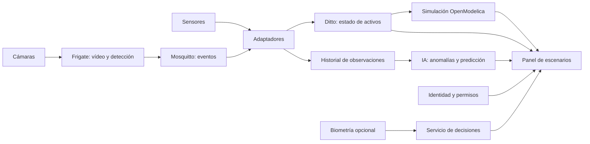

# JFXAI4CBS — Compendio de IA, ciberseguridad y gemelos digitales

Propuesta de reorganización y arquitectura abierta. Revisión: 13 de octubre de 2026.

Fuente: [README original](https://github.com/robotics-intelligent-systems/jfxai4cbs/blob/main/README.md), SHA del archivo `b53bb156218a22ff5dc06e6fe91120e68f23d41b`.

## Propósito y alcance

Organizar recursos para construir una plataforma de simulación y supervisión de sistemas ciberfísicos que integre inteligencia artificial, gemelos digitales, seguridad informática, videovigilancia y biometría. Esta es una propuesta documental: no representa una plataforma implementada ni conectores ya disponibles.

Se conservan todas las entradas del compendio original. Su clasificación es editorial y no certifica licencia, mantenimiento o interoperabilidad. Las incorporaciones recomendadas tienen enlaces a fuentes primarias; las entradas ambiguas quedan pendientes de identificación antes de seleccionarlas.

## 1. Compendio original reorganizado

| Categoría | Entradas originales | Función propuesta en el compendio |
|---|---|---|
| Ingeniería de sistemas y trazabilidad | Arcadia, Capella, JanusTrace | Arquitectura, requisitos y relación con implementación y pruebas |
| Diseño, fabricación y simulación | CAD, CAM, CAS; OpenARIA; SEMLA; Risk Analysis Virtual Environment (RAVEN) | Disciplinas de ingeniería, simulación y análisis de riesgo; verificar identidad de los proyectos |
| Emulación adversaria y evaluación | EnIGMA, Sliver, MITRE Caldera, Active Defense Framework (ADF) | Escenarios de evaluación en laboratorios autorizados y aislados |
| Detección y respuesta | Wazuh, Snort 3, OSSEC, Cortex, NVIDIA Morpheus | Telemetría de seguridad, análisis y respuesta |
| Identidad, autorización y confianza | Casdoor, OpenAM, Apache Shiro, OACC, QED | Autenticación, permisos y relaciones de confianza; verificar QED y distribución de OpenAM |
| Aislamiento y ejecución | MirageOS, Higher-order Virtual Machine 2, KVM-based Virtual Machine Instrospection, Muen | Sistemas de ejecución y aislamiento; una máquina virtual de evaluación de lenguaje no sustituye un hipervisor |
| Seguridad y gobernanza de IA | AI/ML Security WG, ModelScan, garak, NIST AI Risk Management Framework | Seguridad de modelos, evaluación de LLM y gobernanza; grupos y marcos no son componentes ejecutables |
| Observabilidad de IA | Langfuse, LangKit | Evaluación, trazas y seguimiento de aplicaciones con modelos |
| Observabilidad y calidad de software | Apache HertzBeat, Sentry, Kodezi Chronos, scilint, montest | Monitorización, depuración, análisis y pruebas; revisar licencias y disponibilidad de cada edición |
| Cadena de suministro y cumplimiento | LunaTrace, Gapps | Dependencias y cumplimiento; identificar Gapps y comprobar vigencia |
| Esquemas y arquitectura de seguridad | Open Cybersecurity Schema Framework (OCSF), Open Security Architecture (OSA) Data | Semántica común de eventos y referencias de arquitectura |
| Plataformas de IA para ciberseguridad | Cybersecurity AI | Entrada general del original: falta URL para identificar la plataforma concreta |

### Correcciones editoriales y pendientes

- CAD, CAM y CAS son disciplinas, no productos. MBSE significa ingeniería de sistemas basada en modelos; Arcadia es un método y Capella una herramienta de modelado.
- Conservar SEMLA sin repetir la afirmación «encryption of Modelica Libraries» como hecho verificado. Solicitar fuente y confirmar su función.
- Mantener la grafía original «KVM-based Virtual Machine Instrospection» para trazabilidad; normalizar a «introspection» cuando se identifique el proyecto.
- Verificar EnIGMA, OpenARIA, SEMLA, QED, ADF, JanusTrace, montest, RAVEN, Gapps y Cybersecurity AI mediante URL canónica, versión y licencia. Los nombres por sí solos no permiten elegir con certeza una implementación.
- Kodezi Chronos y Sentry permanecen como referencias; no se presupone que todas sus ediciones o servicios satisfagan el requisito de software libre.
- No presentar el conjunto como una pila compatible hasta probar sus interfaces y dependencias.

## 2. Incorporaciones para IA y gemelos digitales

| Proyecto y referencia | Función documentada | Uso propuesto |
|---|---|---|
| [Eclipse Ditto](https://github.com/eclipse-ditto/ditto) | Framework de gemelos digitales; EPL-2.0 | Estado actual de cámaras, sensores, puertas y activos; políticas de acceso |
| [Eclipse BaSyx](https://github.com/eclipse-basyx) | Componentes para Asset Administration Shell (AAS) | Extensión industrial para identidad, propiedades y submodelos de activos |
| [OpenModelica](https://github.com/OpenModelica/OpenModelica) | Modelado y simulación basados en Modelica | Modelos de comportamiento físico y escenarios; comprobar licencia por componente |
| [Eclipse Mosquitto](https://github.com/eclipse-mosquitto/mosquitto) | Broker MQTT abierto | Transporte de eventos y telemetría |
| [MLflow](https://github.com/mlflow/mlflow) | Plataforma abierta de ingeniería de IA | Registro, evaluación y trazabilidad de modelos |
| [ModelScan](https://github.com/protectai/modelscan) | Detección de ataques mediante serialización de modelos | Inspección de artefactos antes de promoverlos; no garantiza seguridad completa |
| [garak](https://github.com/NVIDIA/garak) | Evaluación de vulnerabilidades de LLM | Pruebas del asistente de análisis, si se incorpora un LLM |
| [Wazuh](https://github.com/wazuh/wazuh) | Plataforma abierta de seguridad | Supervisión de hosts y servicios |
| [OCSF](https://github.com/ocsf/ocsf-schema) | Esquema común de eventos de seguridad | Normalización de eventos de seguridad mediante adaptadores |
| [Keycloak](https://github.com/keycloak/keycloak) | Gestión abierta de identidad y acceso | Autenticación central de usuarios y servicios |

Ditto mantiene la representación digital; el historial y los modelos físicos son servicios separados. Para hablar de gemelo digital con capacidad predictiva se requiere sincronización, modelo de comportamiento y validación contra observaciones. Una visualización 3D o una copia del último estado no bastan.

BaSyx es opcional si se necesita intercambio industrial AAS. Utilizar componentes actuales del metamodelo AAS v3; la comunidad identifica DataBridge y los SDK del metamodelo v2 como obsoletos. Fuente: [inventario de BaSyx](https://github.com/eclipse-basyx).

## 3. Videovigilancia de código abierto

| Sistema | Alcance | Licencia o condición | Decisión propuesta |
|---|---|---|---|
| [Frigate](https://github.com/blakeblackshear/frigate) | NVR local, detección de objetos, grabación, RTSP y eventos MQTT | Código MIT; revisar pesos y servicios opcionales por separado | Primera opción del piloto por detección local y publicación de eventos |
| [ZoneMinder](https://github.com/ZoneMinder/zoneminder) | Captura, grabación y supervisión CCTV en Linux; cámaras IP, USB y analógicas | GPL-2.0 según repositorio; comprobar archivos de licencia de la versión | Alternativa para infraestructura CCTV existente; añadir adaptador de eventos |
| [Shinobi](https://github.com/ShinobiCCTV/Shinobi) | Gestión de vídeo; su repositorio GitHub remite a GitLab | Validar términos de la edición y versión concretas antes de incluirla en una pila libre | Referencia complementaria, pendiente de evaluación; [repositorio indicado por el proyecto](https://gitlab.com/Shinobi-Systems/Shinobi) |

Elegir un NVR principal por instalación. El bus recibe metadatos y referencias protegidas a grabaciones; no transporta vídeo completo. La compatibilidad RTSP/ONVIF se debe probar con cada modelo de cámara y perfil. Que el servidor sea libre no implica que el firmware de la cámara lo sea.

## 4. Biometría abierta

| Proyecto | Modalidad e interfaz | Licencia del código | Condición de incorporación |
|---|---|---|---|
| [CompreFace](https://github.com/exadel-inc/CompreFace) | Servicio facial con API REST; detección, verificación e identificación | Apache-2.0 | Candidato para servicio separado; revisar los modelos de la imagen elegida |
| [DeepFace](https://github.com/serengil/deepface) | Biblioteca Python que integra varios modelos faciales | MIT | Comparación experimental de modelos; sus dependencias y pesos tienen términos propios |
| [InsightFace](https://github.com/deepinsight/insightface) | Análisis facial y modelos asociados | MIT para el código | Los modelos preentrenados publicados tienen restricciones de uso no comercial; excluirlos de la base libre sin una licencia adecuada |
| [SourceAFIS](https://github.com/robertvazan/sourceafis-java) | Comparación de huellas y búsqueda por similitud en Java | Revisar LICENSE de la versión elegida | Motor de comparación; adquisición mediante lector y detección de presentación requieren componentes adicionales |

La licencia de una biblioteca no concede automáticamente derechos sobre los pesos o datos de entrenamiento. InsightFace distingue explícitamente código MIT y modelos restringidos: [política del model zoo](https://github.com/deepinsight/insightface/blob/master/python-package/docs/model_zoo.md). DeepFace también exige revisar licencias de los modelos integrados: [sección de licencia](https://github.com/serengil/deepface#licence).

Proponer verificación 1:1 para acceso voluntario y controlado: comparar una muestra con la identidad declarada. Mantener la identificación 1:N fuera del piloto inicial. Distinguir detección de personas, detección de rostros y reconocimiento de identidad. La primera no exige una base biométrica.

La prueba biométrica debe medir falsas aceptaciones y rechazos, calidad de captura y resistencia a fotografías, pantallas u otras presentaciones. El comparador de huellas o rostros no aporta por sí solo prueba de vida. Ofrecer un método alternativo de acceso, guardar plantillas en un servicio separado y definir enrolamiento, revocación y eliminación. Los gemelos representan activos y zonas, sin copiar plantillas biométricas.

## 5. Arquitectura de integración propuesta

### Componentes mínimos

1. **Borde:** cámaras y sensores; Frigate realiza grabación y detección local.
2. **Mensajería:** Mosquitto distribuye eventos autenticados.
3. **Adaptadores:** validan, deduplican y transforman eventos del NVR, sensores y seguridad.
4. **Gemelos:** Ditto conserva el estado de activos y zonas; una base histórica conserva observaciones y sus marcas temporales.
5. **IA:** un servicio evalúa anomalías y predicciones; MLflow conserva versiones y resultados de evaluación.
6. **Simulación:** OpenModelica ejecuta escenarios de comportamiento; BaSyx se añade cuando se requiera intercambio AAS.
7. **Operación:** panel de activos y alertas; Wazuh supervisa los hosts y Keycloak gestiona usuarios. Adaptar la autenticación de cada servicio según sus capacidades.
8. **Biometría opcional:** un servicio independiente realiza verificación y devuelve un resultado limitado al contexto autorizado.



El diagrama expresa conexiones por desarrollar. No supone integración nativa entre Ditto, OpenModelica, Wazuh o los motores biométricos.

### Contratos e interoperabilidad

- Identificador estable `asset_id` para cada cámara, sensor, puerta y zona; conservar un registro de correspondencias entre sistemas.
- Cada evento incluye identificador único, versión de esquema, origen, activo, tiempo de observación, tiempo de recepción, tipo y calidad. Sincronizar relojes y marcar estados obsoletos.
- MQTT para eventos; RTSP para vídeo; API HTTP documentada para consultas. OIDC/OAuth2 para clientes compatibles y credenciales específicas para servicios que no los soporten.
- JSON Schema y contratos de API versionados. Convertir los eventos de seguridad a clases OCSF apropiadas; usar esquemas de dominio separados para telemetría física y vídeo.
- MQTT puede entregar duplicados. Los adaptadores deben tolerarlos y conservar orden por activo; añadir almacenamiento persistente y reproducción cuando el broker no cubra la recuperación requerida.
- FMI/FMUs es una opción de intercambio de modelos de simulación; verificar exportación, versión y compatibilidad en el piloto. AAS es una opción de intercambio industrial, no un sustituto del simulador.

Ejemplo de evento de dominio propuesto —no es un mensaje nativo de Frigate ni un evento OCSF—:

```json
{
  "schema_version": "1.0",
  "event_id": "evt-0001",
  "asset_id": "camera-entrada-01",
  "zone_id": "entrada-principal",
  "observed_at": "2026-10-13T15:00:00Z",
  "received_at": "2026-10-13T15:00:00.150Z",
  "type": "vision.person_detected",
  "source": "frigate-adapter",
  "model_version": "detector-piloto-v1",
  "confidence": 0.92,
  "evidence_ref": "evidence/evt-0001"
}
```

`evidence_ref` es una referencia interna con autorización; `confidence` no equivale a probabilidad de una amenaza ni a certeza de identidad.

### Escenario demostrador

Una detección en una zona actualiza su estado de ocupación estimada. El servicio correlaciona ese evento con el sensor de puerta y la telemetría del activo. La IA propone una alerta cuando hay una combinación anómala; el operador consulta la evidencia autorizada. El gemelo simula consecuencias y compara escenarios antes de una intervención.

Un sensor de puerta indica apertura o cierre, no cuántas personas pasaron. Validar conteo, oclusión y cobertura antes de usar ocupación para decisiones. Los resultados simulados se almacenan separados del estado observado. Las pruebas adversarias del compendio se ejecutan en una red de laboratorio y sus eventos se etiquetan para no confundirse con producción.

### IA aplicada

- Empezar con reglas y modelos estadísticos de referencia; medir si un modelo más complejo mejora resultados.
- Detectar cámara desconectada, señal congelada, deriva del sensor y patrones anómalos; cada detector necesita datos y evaluación específicos.
- Usar predicción para mantenimiento y contraste entre estado previsto y observado; recalibrar modelos físicos con datos medidos.
- Si se incorpora un LLM, limitar su función inicial a explicar eventos y consultar documentación con fuentes. No necesita acceso a plantillas biométricas ni capacidad de accionar puertas.
- Registrar versión del modelo, procedencia de datos, métricas y decisión humana. ModelScan evalúa riesgos de serialización y garak vulnerabilidades de LLM; no sustituyen evaluación funcional.

### Operación y protección de datos

Separar redes de cámaras, servicios y laboratorio; cifrar enlaces donde el dispositivo lo permita y usar pasarelas protegidas para equipos heredados. Establecer permisos por activo, zona y función. Mantener grabaciones y plantillas fuera de los registros generales; controlar acceso a evidencias y auditar consultas.

Definir plazos de conservación por finalidad, eliminación y restauración, incluidos respaldos. La biometría se habilita únicamente después de evaluar su finalidad, autorización aplicable y funcionamiento con la población y condiciones del piloto. Estas son decisiones de diseño propuestas, no una afirmación de cumplimiento legal para una jurisdicción determinada.

## 6. Ruta de implementación y aceptación

| Etapa | Entregable | Criterio de aceptación |
|---|---|---|
| 1. Depuración del catálogo | Fichas con URL, versión, SPDX, mantenimiento y restricciones de modelos | Todos los componentes seleccionados identificados; ningún componente ambiguo en la base |
| 2. Piloto de vídeo y eventos | Frigate, Mosquitto, adaptador y dos gemelos de activos | Un evento actualiza el activo correcto; duplicados no duplican alertas; caída y reconexión probadas |
| 3. Historial y simulación | Registro reproducible y modelo físico de un activo | Reproducción consistente; error del modelo medido frente a observaciones y estados obsoletos visibles |
| 4. IA y seguridad | Modelo de referencia, evaluación y telemetría de hosts | Precisión, exhaustividad, falsas alertas, latencia p95 y consumo medidos en el escenario objetivo |
| 5. Biometría opcional | Verificación 1:1 con alternativa de acceso | Falsas aceptaciones y rechazos medidos; prueba de presentación; eliminación de plantillas comprobada |
| 6. Escalado | Despliegue reproducible, respaldo y recuperación | Carga esperada y pérdida de servicios probadas; restauración documentada y auditada |

Los umbrales de aceptación se fijan antes del piloto según riesgo, número de cámaras, resolución, frecuencia de inferencia y hardware. No se promete rendimiento sin medición. El esfuerzo y calendario dependen de ese alcance.

## 7. Organización propuesta del repositorio

La siguiente estructura es una propuesta; el repositorio consultado contiene únicamente README.md.

```text
README.md
docs/
  compendio.md
  arquitectura.md
  decisiones/
  licencias-y-modelos.md
engineering/
  mbse/
  cad/
  cam/
  cas/
catalog/
  components.yaml
schemas/
  events/
services/
  adapters/
  twins/
  inference/
  biometrics/
deploy/
  pilot/
tests/
  integration/
  simulation/
```

Cada ficha de `components.yaml` debe registrar nombre, categoría, URL canónica, versión o commit, licencia del código, licencia de pesos/datos, interfaces, estado de evaluación y fecha de revisión. Las fichas separan recursos del original, incorporaciones propuestas y componentes aceptados para despliegue.

La base recomendada es Frigate + Mosquitto + adaptadores propios + Ditto, con historial, identidad y supervisión. Añadir simulación e IA tras validar el flujo de eventos, y biometría como módulo opcional con modelos cuyo uso y distribución sean compatibles con el objetivo de software libre. Mantener los servicios sustituibles mediante contratos documentados y despliegues reproducibles.
